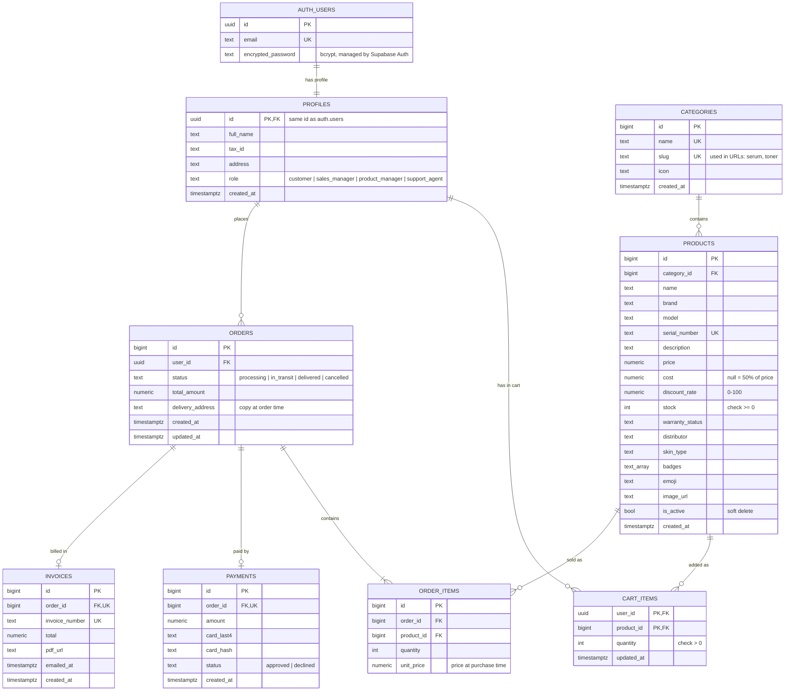
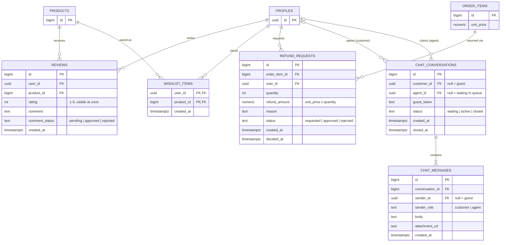

# SkinWise · Database ER diagram

The database runs on Supabase (PostgreSQL). Every table below is created by one script:
[`backend/supabase/schema.sql`](../backend/supabase/schema.sql) (Jira DP-14).

GitHub draws the diagrams below automatically.

## 1. Shopping flow: catalog, cart, order, payment, invoice

## 2. After the sale: reviews, wishlist, refunds, live support

## Views (computed, no copied data)

| View | What it returns | Used for |
|---|---|---|
| `product_catalog` | Active products with category slug, average rating, review count, units sold and final (discounted) price | Shop pages, sorting by popularity |
| `delivery_list` | One row per order item: delivery ID, customer ID, product ID, quantity, total price, address, completed flag | Product manager's delivery list (requirement 12) |

## Key design decisions

| Decision | Why | Requirement |
|---|---|---|
| Categories are a separate table, products point to them with `category_id` | Product managers add and remove categories; a typo cannot create a second category | 12 |
| `order_items.unit_price` stores the price at purchase time | Old orders and invoices never change when prices change; refunds pay back the discounted price | 16 |
| `products.stock` has `check (stock >= 0)` | Two customers buying the last item at once cannot push the stock below zero | 3, 18 |
| Products are deactivated (`is_active = false`), never deleted | Old orders and invoices still point to them | 12 |
| Sign-up and login use Supabase Auth: passwords live in `auth.users` as bcrypt hashes. `profiles` shares the same uuid and is filled by the `on_auth_user_created` trigger | We never store or handle plain passwords | 14, 17 |
| No card numbers are stored, only the last 4 digits and a hash | Card data must not be readable | 15, 17 |
| Guest cart lives in the browser (localStorage); a logged-in user's cart lives in `cart_items` | Guests can shop without an account; the cart is merged into `cart_items` at login | 4 |
| `reviews.rating` is visible at once, `comment_status` starts as `pending` | Ratings need no approval, comments need the product manager's approval | 5 |
| Refunds point to one `order_item`, not the whole order | Customers return products selectively | 16 |
| Average rating and popularity are computed in a view, not stored | A stored copy would drift out of date | 5, 7 |
| Status columns use `text` + `check` instead of Postgres enums | Easier to change later | — |
| Row Level Security is on for every table; only categories and active products are publicly readable, and a logged-in user can read only their own profile | Everything else is reachable only through the backend | 17 |
